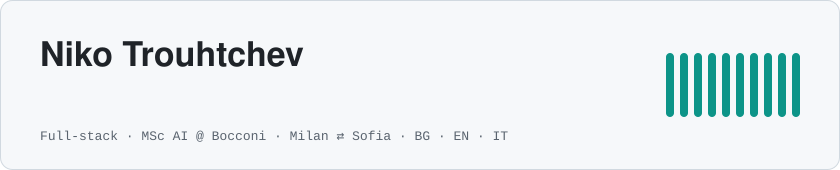
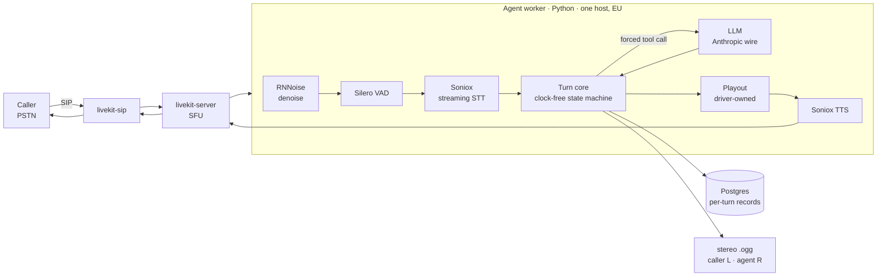
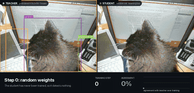
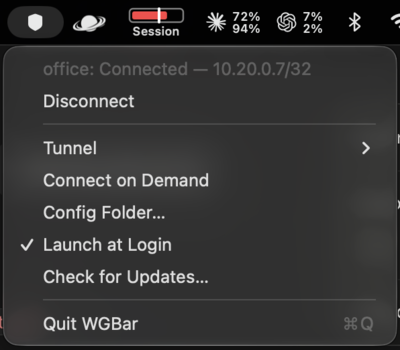

<picture>
  <source media="(prefers-color-scheme: dark)" srcset="assets/banner-dark.svg">
  
</picture>

Full-stack engineer building AI products for the Bulgarian market. MSc in Artificial
Intelligence at Bocconi (2026–28); BSc Economics, Management and Computer Science, Bocconi.
Milan / Sofia.

  
  
  
  
  

## Now

<b><a href="https://github.com/Nikohtr/obadise-voice-agent">Obadi.se</a></b> — founder · an AI phone receptionist that speaks Bulgarian

 

Answers a real Bulgarian phone number on a self-hosted stack, holds the conversation in
Bulgarian and files a structured lead. First deployment: after-hours lead capture for an SME
lender. Next: dental and medical clinics. A clock-free turn engine where **code owns the record
and the LLM owns the plan**.

| ~0.65 s | 5.4 % | 75 / 525 | 2.8× |
|:--|:--|:--|:--|
| one-way line delay, measured with a click tone | truncation at the 0.8 s floor (242 live turns) | calls / turns per synthetic-caller campaign | more Anthropic tokens for the same Cyrillic text |

Registered acceptance gates, synthetic-caller campaigns, 3,400+ tests.
*[Architecture write-up](https://github.com/Nikohtr/obadise-voice-agent); the code is private.*

<b><a href="https://monexo.bg">Monexo</a></b> — full-stack engineer at a Bulgarian fintech (fast SME credit lines)

 

SvelteKit / Svelte 5, Drizzle, PostgreSQL: payment allocation, balance-chain integrity, document
generation, admin tooling. Also run its Meta and Google Ads.

## Open source

<table>
<tr>
<td width="50%" valign="top">

 **[Sweep](https://github.com/Nikohtr/sweep)** · Swift · GPL-3.0 · free 
Tidy your Mac with two fingers. Swipe, pinch or tap on a titlebar to snap, move, minimize
and close windows. 
macOS 14+ · universal · 480+ tests

How it works

Also works on Dock icons, the menu bar, tabs and Mission Control. A pure-logic core (gesture
state machine, snap geometry) with 480+ tests driven by synthetic touch frames;
Accessibility-API window control; signed in-app updates.

</td>
<td width="50%" valign="top">

**[yolo-distillation](https://github.com/Nikohtr/yolo-distillation)** · Python · PyTorch · AGPL-3.0 
Watch a blank YOLOv8 learn from a trained one, live, side by side. 
94.8 % of teacher boxes in 30 min · 5.65 steps/s at 320 px on Apple silicon

How it works

Response-based distillation on the decoded pre-NMS head (soft-target BCE + confidence-masked
L1), with a replay buffer, webcam/slideshow sources and time-lapse recording, plus a patch that
exposes full per-box class probabilities through Ultralytics `Results`. Honest result: the
student memorises the photos it trains on; on held-out photos it stays at 0 %.

</td>
</tr>
<tr>
<td width="50%" valign="top">

 **[axiom-review](https://github.com/Nikohtr/axiom-review)** · TypeScript · Next.js 16 · MIT 
Paste a URL, get a grounded UX and accessibility review. 
every finding pinned to a CSS selector and a screenshot of that element

How it works

Playwright loads the page at desktop and mobile size and audits the live DOM. Claude must cite
a CSS selector for every finding; each selector is re-screenshotted in the open browser, and
selectors that do not resolve are dropped.

</td>
<td width="50%" valign="top">

**[wgbar](https://github.com/Nikohtr/wgbar)** · Rust · objc2 · MIT 
A tiny macOS menu bar toggle for `wg-quick` WireGuard tunnels. 
~2,900 lines of Rust · macOS 13+

How it works

Connect-on-demand via an "armed" interface so the first connection never fails, automatic DNS
repair on launch, wake and network change, and a least-privilege root helper.

</td>
</tr>
</table>

<b>Before</b> — thesis, InsiderWallets, Postbank

 

- Bachelor's thesis: online learning for call-centre staffing under demand uncertainty —
  UCB1 / LinUCB / bandits-with-knapsacks against Prophet-based forecasts.
- Founded InsiderWallets, a crypto wallet-analytics product (150+ users; wound down).
- Customer Intelligence & AI intern at Postbank Bulgaria (demand forecasting, ~5 % MAPE).

Bulgarian · English · Italian

